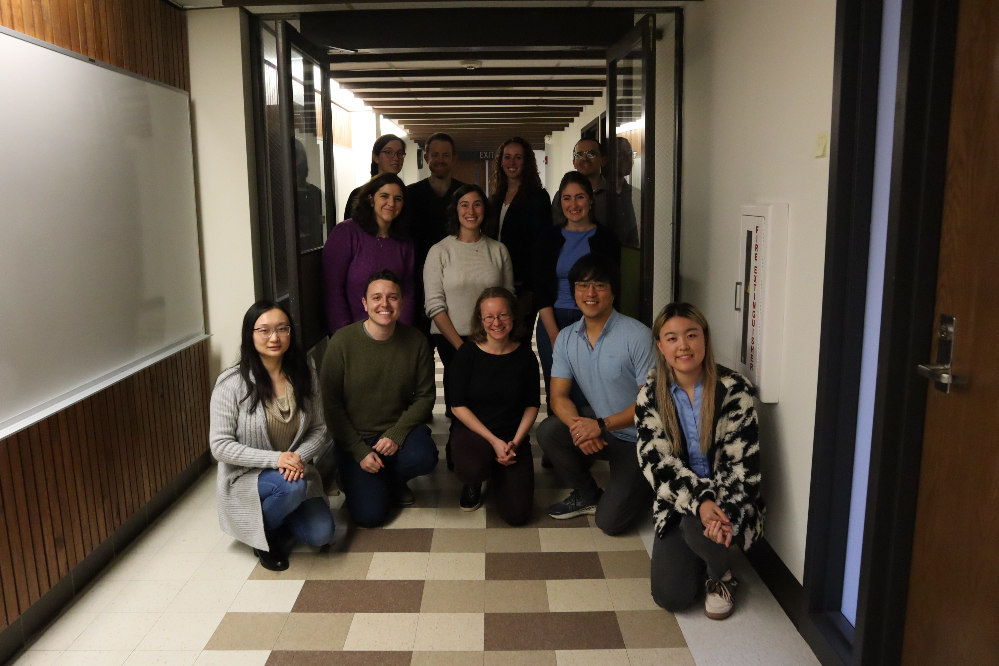

This website is managed by the SDS faculty:

- For our official website, please visit [smith.edu](https://www.smith.edu/academics/statistical-data-sciences).
- For additional information on our major and minor, please see this [page](https://docs.google.com/document/d/1FY2vdUIQKBC2VlXfY1NkkBPWHJADH0O1ukUPMU02xRE/edit?usp=sharing).
- To declare an SDS major or minor, an MST major, or an STS minor, please complete the [adviser form](https://docs.google.com/forms/d/e/1FAIpQLSeTJ2uHDFvLD7cTL39GQHF32OhbU7dd-d32_DaKHsEDHW8JWg/viewform). 
- Please review our [list of previously-approved application domain courses](https://docs.google.com/spreadsheets/d/14Av6JurSJdv1oLCBMulkV84-uxsd2FfqtPjTJScJHdU/edit?gid=0#gid=0).

## Who we are

-   Top row: Katherine M. Kinnaird, William Hopper, Casey Berger, Nic Schwab
-   Middle row: Rebecca Kurtz-Garcia, Randi Garcia, Lindsay Poirier
-   Bottom row: Shiya Cao, Scott LaCombe, Kaitlyn Cook, Albert Kim, Hualong Xu (student representative)
-   Not pictured: Ben Baumer, Kelley Dunphy (administrative coordinator), Ab Mosca, Yujie Wang, Kementari Whitcher

```{r, echo = FALSE}

```
